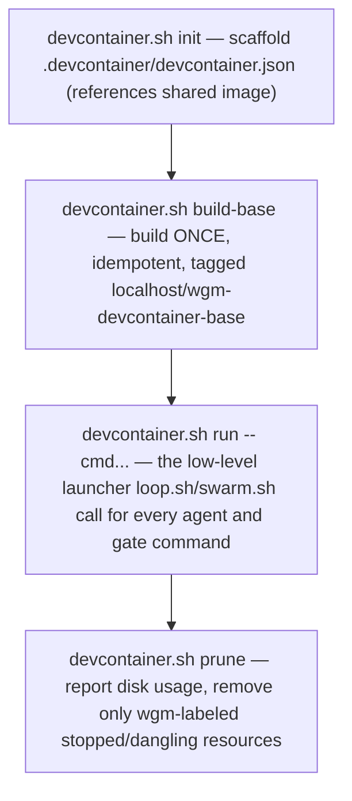

# Local devcontainer sandbox (operator)

## Executive overview

- **For:** operators running an autonomous Ralph-full loop (`scripts/loop.sh`) or a swarm
  (`scripts/swarm.sh`). **The sandbox is the default**: with Podman or Docker installed, every agent
  and gate command runs in a throwaway container and the agent's file access is capped as described
  under [What the sandbox guarantees](#what-the-sandbox-guarantees).
- **What it is:** a throwaway OCI sandbox, **Podman-first** with a Docker fallback, built around
  **one shared, prebuilt base image reused across every project** — not a new multi-GB image per
  project.
- **Opting out:** `--no-devcontainer` or `WGM_DEVCONTAINER=0` runs on the host, labelled
  `sandbox: OFF — unsandboxed (<REASON>)` in the log and in the metrics `sandbox` column. `--devcontainer`
  (or `WGM_DEVCONTAINER=1`) *forces* the sandbox: no working engine means exit 2, never a host run.
- **No engine installed:** an interactive run explains it once, offers install commands for your
  OS, and asks one question; a headless run fails closed (exit 2) with the same guidance.
- **Fastest path:** install Podman (or Docker), then `scripts/loop.sh build` — the first run asks
  once which agent credentials to copy in, records the answer per repository, and reuses it.
- **Next:** [running-the-loop.md](running-the-loop.md) · [troubleshooting](troubleshooting.md#sandbox-default-devcontainer) ·
  [containers.md](containers.md) (the *other* container use case — validating the app under test).

## Two different container use cases — don't confuse them

| | `loop.sh --container` (`containers.md`) | the loop sandbox (this doc) |
|---|---|---|
| Runs | the **app under test** | the **agent and gate commands** |
| Purpose | let the judge grade real running behavior | isolate an autonomous run from the host |
| Lifespan | one scenario | each agent/gate invocation |
| On by default? | no — only when a scenario needs a live service | **yes** (`--no-devcontainer` opts out) |

## What the sandbox guarantees

**Guarantee (practical containment).** The agent cannot read or write anything outside the project
(or lane) tree, this repository's git store, and its own credential copies. wgm itself never follows
agent-written symlinks, never consumes agent-redirected git metadata, never runs hooks, filters or
fsmonitor of an agent-written tree on the host, and never executes scripts the agent can edit. Nothing the agent writes inside the container persists outside the project tree and this repository's git directory, and that git directory's executable configuration (`config`, `config.worktree`, `hooks`, `info`, `objects/info`) is read-only inside.

**Residual risk — read this.** A deliberately hostile agent can change this repository's *content and
history* (the repository's git objects and refs are writable inside, because lanes commit) and so
influence tools that *later* process the repository outside wgm: your own host commits and hooks, CI.
The sandbox protects your home directory, credentials and other projects — **not this repository's
history**. Further recorded limits: swarm's parent guard runs host Git *porcelain* on your parent checkout (no container ever mounts the parent checkout; swarm's preflight runs in a throwaway preflight workspace at the parent's HEAD, removed afterwards; with hooks, fsmonitor and transports disabled and an empty protocol allowlist), and lanes can write the
parent's index in the shared git directory, so the guard's verdict can be skewed (no code runs); sibling swarm lanes share one git store with no quiescence
protocol yet (a sibling can change shared refs between two host reads); on SIGINT/SIGTERM swarm TERMs every lane group and a supervised preflight, waits up to 24 s (cleanup deadline 16 s + 8 s margin) for their bounded
container cleanup and retained-handle reporting, then KILLs what remains and reaps every name left in the shared live-container registry,
printing the exact `retained container <NAME>` for any it cannot confirm gone (an interrupted swarm can take up to ~24 s to exit); a socket created later
by a host process inside a mounted tree is not detected; separate containers do **not** give each lane
its own git authority. Separate containers also do not make the parent/lane guards a sandbox — the
guards remain tripwires.

**Platform scope.** Field-validated on Linux with Podman. macOS (Podman machine, Docker Desktop) and
WSL rely on the readiness probe to fail closed; their field validation is a follow-up.

## Host vs container — who does what

| Runs on the **host** (unchanged) | Runs in the **container** |
|---|---|
| `loop.sh` and `swarm.sh` themselves, guards, git bookkeeping (plumbing only on agent-written trees; swarm's parent guard also runs porcelain on the operator's own parent checkout), metrics, telemetry | every agent invocation (`--` argv, `--agent`/`$WGM_AGENT`, the frugal agent, the capability probe) |
| creating, integrating and removing jj workspaces / Git worktrees (jj is not in the shared image, and its Git is too old for `worktree add --orphan`) | every gate/validation command (run exactly as `bash -c "$gate"` would on the host — quotes, `$VAR` and `&&` unchanged) and every `--notify` / `--cost-cmd` string |
| host Git reads: `rev-parse`, `rev-list`, `for-each-ref`, `show-ref`, `cat-file`, `merge-base`, `show <REV>:<PATH>` — always with hooks, fsmonitor and transports disabled | git commands that can run repository programs: `status`, `add`, `commit`, `diff`, `checkout`, `stash`, `merge`, `rebase` — the repository's real hooks run, contained |

Consequences: a desktop-notification `--notify` needs a webhook or `--no-devcontainer`; host-side
Git never runs hooks (they run in the container); a partial clone needs its objects present (host
reads never fetch) or `--no-devcontainer`. Files the agent must read or write (probe file, ownership
manifest, prompt file) live under `<PROJECT>/.wgm/run/`. The `--devcontainer` flag keeps its name but
means this boundary; the old whole-loop re-exec is gone. While the Git loop owns a lane's commits,
never move the lane's HEAD (`jj new`, rebase, branch switch) from anywhere.

## Mounts — the full inventory

Every container gets exactly these, nothing else; the host `$HOME` is never mounted. Nothing the agent writes inside the container persists outside the project tree and this repository's git directory; that directory's executable configuration (`config`, `config.worktree`, `hooks`, `info`, `objects/info`) is read-only inside.

| Mount | Mode | Purpose |
|---|---|---|
| the project (or lane) tree, at its **same absolute path**, also the working dir | rw | the agent's work |
| when `.git` is a file (jj workspace / Git worktree): the repository's git common dir, at the same path | rw | commits (objects, refs, index/admin files) |
| on top of that git dir: `config`, `config.worktree`, `hooks/`, `info/`, `objects/info/`, every `worktrees/*/config.worktree` | **ro** | executable git configuration the agent must not edit (missing ones are created empty on the host first) |
| per agent: a **throwaway copy** of its token file and the top-level regular files of its config dir, at `$HOME/<REL>` (`/home/wgm/<REL>` in the shared image) | rw (copy) | the agent can authenticate; nothing it writes there reaches the host; the copy is deleted after the run |
| the wgm skill bundle, at its host path and at the agent's skills dir under the container `$HOME` (`~/.agents/skills/wgm` plus the agent-specific dir) | **ro** | the agent has its skill inside the sandbox; it cannot modify wgm |
| the agent CLI's (and `node`'s) install prefix, when outside the project/git dir and not under an OS-owned prefix (`/usr`, `/bin`, `/sbin`, `/lib*`: image-provided, never mounted) | ro | so the CLI resolves; derived statically (see below) |
| extra `--devcontainer-mount` entries you approved | **ro** | explicit, regular files or directories only |

**Mounts are derived at every launch from the working tree** — the project, the git common dir, and the
read-only overlays (including each worktree's own `config.worktree`) are computed fresh each time, never read
from a stored decision. A decision (the record, preflight output, or a swarm's `WGM_SANDBOX_DECISION`) carries
only credentials, env names, the image and your approved extra mounts; a decision that names the project, the
common dir or an overlay as a mount is refused.

`~/.gitconfig` is **not** mounted: commits use `GIT_AUTHOR_NAME/EMAIL` and `GIT_COMMITTER_NAME/EMAIL`
taken from the host's `git config`. Inside, git runs with `gc.auto=0` and `maintenance.auto=false`.
All binds are **non-recursive**; an engine that cannot do that fails with exit 2.

**Install-prefix derivation (no host `npm`/`node` is ever run).** Each agent's first word and `node`
are located (path as given, else `command -v` on a sanitized `PATH`) and canonicalized. A binary
inside the project or git dir needs no extra mount. Otherwise: a path containing `/lib/node_modules/`
→ the part before it; `<DIR>/bin/<NAME>` → `<DIR>`; else the binary's own directory. A prefix that
violates the mount policy (e.g. `$HOME` itself) is refused naming the binary and the prefix. OS-owned prefixes (`/usr`, `/bin`, `/sbin`, `/lib`, `/lib32`, `/lib64`, `/libx32`) are never mounted; a CLI installed there must be provided by the image — the readiness probe proves it, otherwise exit 2 with the project-image recipe. Every other derived prefix is checked and mounted read-only, or refused with a named exit 2.

**Mount policy — refused with exit 2, naming the culprit:** a source that is `/`, `$HOME` or a parent
of it, or is/contains/lies inside `~/.ssh`, `~/.gnupg`, `~/.aws` or the effective record directory;
two mounts landing on one container path; a canonical project or git dir exposed twice; an explicit
mount that is `rw`, a socket, a device or a FIFO; a directory that contains a socket, device or
FIFO (scan at launch), lies in or contains a runtime tree (`$XDG_RUNTIME_DIR`, `/run`, `/var/run`,
`/proc`, `/sys`, `/dev`), contains another mount point, or contains a directory wgm cannot inspect (permissions or
I/O — fail closed, exit 2 before any container, naming the path; entries that vanish during the scan, e.g. another
lane or the parent guard at work, are not failures); any regular file with more than one hard
link inside a writable mount (the message names it and suggests e.g. `git repack -a -d && git
prune-packed`); a repository config `include.path` target inside a writable mount.

## Credentials — a throwaway copy, never your login

Sandboxed agents never see your real credential files. Per agent (basename of the command's first
word), the sandbox *copies* its token file and the top-level regular, non-executable files of its
config directory (never subdirectories such as `extensions/`, `plugins/`, `hooks/`, `sessions/`)
into a private `0700` directory outside every mount, mounts that copy, and deletes it after the run.

| Agent | Token file | Config dir | Env names (passed by name only) |
|---|---|---|---|
| `pi` | `~/.pi/agent/auth.json` | `~/.pi/agent` | — |
| `claude` | `~/.claude/.credentials.json` | `~/.claude` | `ANTHROPIC_API_KEY` |
| `codex` | `~/.codex/auth.json` | `~/.codex` | `OPENAI_API_KEY` |
| `gh` | `~/.config/gh/hosts.yml` | `~/.config/gh` | `GH_TOKEN`, `GITHUB_TOKEN` |
| `copilot` | — | `~/.copilot` | `GH_TOKEN`, `GITHUB_TOKEN`, `COPILOT_GITHUB_TOKEN` |

An unknown agent gets nothing proposed. Only files that exist and env names that are set are
proposed. **Env values are never written anywhere** — they reach the container only through the
engine's name-only form (`--env NAME`), so they never appear in a file, record, log, telemetry line
or command line: wgm's host-side clean environment is built in-process (no `env NAME=value` arguments), and
credentials reach the container by NAME only. Every token file listed in the approval record must still be a
readable regular file at each run; a missing or unreadable one exits 2 `credential <FILE> not reachable`.
Because refreshed tokens are *not* written back, a provider that rotates OAuth
refresh tokens may need an occasional host re-login; **API-key env auth is recommended for sandboxed
runs** (a non-rotating login such as pi's GitHub Copilot token is unaffected). Preflight checks that
credentials are *reachable* (readable on the host, readable in the container copy, env names
non-empty); it does **not** verify the login — a bad login surfaces at the agent's first real call.

## The decision record — approve once per repository

The sandbox asks you at most once per repository and remembers:

- **Path:** `${XDG_CONFIG_HOME:-$HOME/.config}/wgm/sandbox/<REPO-KEY>.yml`, where `<REPO-KEY>` is the
  first 16 hex characters of the sha256 of the canonical path of the repository's git common dir (a
  non-git project: its canonical directory). All workspaces and lanes of one repository share it.
- **Operator-owned:** file `0600` in a `0700` directory, owned by you, never mounted into any
  container, atomically written under locks on every write: **every** writer takes the owner-record lock FILE
  `<DIR>/.lock.own` (created atomically together with its owner record: process id + start time) **and also** `flock <DIR>/.lock` where `flock` exists; a stale `.lock.own` — owner gone, reused pid, or older than 120 s — is broken automatically under a short breaker mutex `<DIR>/.lock.break`; a live holder → exit 2 naming the lock). A record that is a symlink, not yours, or group/world
  writable is refused (exit 2); a malformed record counts as absent. Nothing inside the project is
  ever read as a record — a repository-shipped `.wgm/sandbox.yml` has no effect.
- **Format** (plain lines):

```yaml
# wgm sandbox decisions — operator-owned; never inside a repository
engine_declined: false
declined_at:
agents: codex pi
image:
tokens:
  - /home/you/.pi/agent/auth.json
copies:
  - /home/you/.pi/agent
mounts:
env:
  - ANTHROPIC_API_KEY
```

**Interactive setup.** On a TTY, preflight shows the proposal and asks once
`Mount these into the sandbox? [Y/n]` (`n` → exit 2). Later runs reuse the record silently. You are
asked again only if the set of agents changes, a token file's canonical target changed, or a config
dir became a symlink; a newly installed engine always wins over a recorded decline.

**Headless provisioning.** Headless runs (no TTY, swarm lanes, CI) never decide for anyone: without
a valid record they exit 2 with the fix-it message. Provision once from a terminal —
`scripts/sandbox.sh preflight --interactive yes --agent-cmd '<YOUR AGENT COMMAND>'` — or write the file
above yourself (`umask 077; mkdir -p -m 700 "$dir"`, then the `0600` file; canonical absolute paths).

**Verify it is outside every mount:**

```bash
key_dir="${XDG_CONFIG_HOME:-$HOME/.config}/wgm/sandbox"
ls -ld "$key_dir" "$key_dir"/*.yml      # drwx------ / -rw------- , owned by you, not symlinks
case "$(realpath "$key_dir")/" in "$(realpath .)"/*) echo "INSIDE the project — set XDG_CONFIG_HOME elsewhere";; esac
```

If the record directory lies inside, equals or contains any mount source, preflight exits 2 — set
`XDG_CONFIG_HOME` outside them.

**Inspect, change, revoke.** The record is plain text: `cat` it (it holds paths and env *names*,
never credentials). Change an approval by editing the file or deleting it (the next interactive run
re-asks); revoke credentials by deleting the file; **clear an engine decline** by setting
`engine_declined: false` (or deleting the file) — it applies only while no engine is detected, and
installing Podman or Docker overrides it anyway.

## Decision order (first match wins)

1. already inside a sandbox (`WGM_IN_DEVCONTAINER`) → `inside`. 2. `--devcontainer` with
`--no-devcontainer`, or a flag contradicting `WGM_DEVCONTAINER` → exit 2 "conflicting sandbox choices".
3. `--no-devcontainer` / `WGM_DEVCONTAINER=0` → off (`operator-flag` / `operator-env`). 4. Forced
(`--devcontainer` / `WGM_DEVCONTAINER=1`) needs a working engine, else exit 2 (a recorded decline never
turns a forced run off). 5. Engine detection: Podman, then Docker (`info` must succeed); found → sandbox.
6. No engine: recorded decline → off (`recorded-decline`); interactive → one notice with install
commands for your OS and one `Proceed without a sandbox and remember this? [y/N]` (`y` records the
decline); otherwise exit 2. 7–8. Agents and credentials as above. 9. Image: `--devcontainer-image` →
`WGM_DEVCONTAINER_IMAGE` → record `image:` → the shared base tag. 10. Readiness probe. 11. Smoke.

`scripts/sandbox.sh preflight` prints `key=value` lines (`sandbox`, `engine`, `reason`, `agent`,
`mount`, `env`, `image`, `record`). Exit **0** decision made · **2** fail closed — no iteration and no
lane started (a readiness or smoke container may have run and been removed) · **1** internal error.
Exit 2 from an already-running loop (agent-written symlink, git metadata or configuration changed) is
a different phase: that iteration ran, and the loop stops before any further host action.

**Readiness probe (every sandboxed start).** Inside the container with the decided mounts: (a) each
agent's first word resolves and executes (`command -v` plus a no-op such as `--version`; any exit
code except 126/127 or "exec format error"), the project path is the working directory and
`git -C <PROJECT> rev-parse` works; (b) credentials reachable (above); (c) provider authentication —
**not** verified.

The three tiers are reported separately, one line each on stderr (names and paths only, never a value), after readiness and the
in-container credential reachability check succeed (the stdout `key=value` decision format is unchanged):

```
sandbox readiness [1/3] agent executable available in the container: claude — OK (ran `--version` inside)
sandbox readiness [2/3] approved credentials reachable (host and inside the sandbox): env name ANTHROPIC_API_KEY — OK
sandbox readiness [3/3] provider authentication: NOT verified by wgm (a valid login/token for the provider is the operator's responsibility)
```

With nothing approved, tier 2 reads `…: none approved (nothing to reach)`; token files are listed as `token file <HOST PATH>` and config-dir copies by count.
A resolvable agent that exits 126/127 on `--version`, or prints "exec format error", fails with `sandbox readiness failed: agent CLI … ` and
the project-image fix below.

**Toolchain smoke.** When a gate command is configured (`--gates FILE`), preflight runs it once inside
the container before any iteration or lane — in **every** mode (`analyze`, `plan`, `review`…, not only `build`). On failure: interactive — you see the tail and the image
recipe below and are asked once whether to proceed anyway (nothing recorded; every iteration's own
gate still runs and still fails the iteration); headless — exit 2. There is never a silent host
fallback.

**Missing toolchain → project image.** The shared image is generic. Add what your gates need in a
project image, build it, then select it:

```dockerfile
# .devcontainer/Containerfile
FROM localhost/wgm-devcontainer-base:latest
USER root
RUN apt-get update && apt-get install -y --no-install-recommends <YOUR-TOOLCHAIN> && rm -rf /var/lib/apt/lists/*
```

The following is ONE bash block; it runs exactly as published and its only parameters are the engine, the image tag and the
Containerfile path (the first line):

```bash
ENGINE=podman; TAG=localhost/wgm-project:dev; CF=.devcontainer/Containerfile
# Docker users set ENGINE=docker on the line above.
"$ENGINE" build -t "$TAG" -f "$CF" . && "$ENGINE" image inspect "$TAG" > /dev/null && echo "built $TAG — now run wgm with: --devcontainer-image $TAG"
```

Then run the loop or swarm with `--devcontainer-image "$TAG"` (or
`WGM_DEVCONTAINER_IMAGE`, or `image:` in the record); rerunning preflight then passes the readiness probe. The loop selects its image only by `--devcontainer-image`, `WGM_DEVCONTAINER_IMAGE`, the approval record's `image:`, or the
shared base image, in that order; `devcontainer.json` is for editors only and does not select the loop's image.

**Containment loss is terminal for the whole swarm.** If any lane (or the preflight) cannot confirm that one of its containers is gone, or swarm's own container sweep cannot confirm absence, swarm stops: it prints every `retained container <NAME>` with its recovery (`podman rm -f -t 0 <NAME>` / `docker rm -f <NAME>`, then verify absence), reports every lane and the preflight workspace as retained with their recovery lines, exits non-zero, and does **not** inspect lanes, consolidate memories or tear anything down — even with `--cleanup`. Recovery order: remove the containers and verify they are gone, then inspect/merge the lanes, then clean up (`jj workspace forget <NAME>` / `git worktree remove`), then rerun.

## Host git protections

Host git protections are set in the environment of wgm's whole host process tree (`GIT_CONFIG_COUNT`/`KEY`/`VALUE`
for `core.fsmonitor=false`, `core.hooksPath=/dev/null` and `protocol.allow=never`; `GIT_ALLOW_PROTOCOL` set and empty;
`GIT_NO_LAZY_FETCH=1`; `GIT_TERMINAL_PROMPT=0`), so helper scripts, lane loops and git spawned by jj inherit them;
they are never passed into containers. Consequence: wgm's host-side git never runs a repository-configured command — hooks, fsmonitor, transports, filter drivers (clean/smudge/process), diff drivers (textconv/command), `diff.external`, credential helpers, the pager and the editor are all disabled for wgm's own host git calls. Trade-off: a file under a filter (e.g. Git LFS) whose timestamp changed may look modified to wgm and the run stops (fail closed); run `git status` yourself once in the checkout to refresh the index, then rerun.

## Host git-dir entry checks

**Pointers first.** Pointer files are read only after every ancestor directory is verified as a real directory (a symlinked worktree
admin dir → exit 2 before anything is read; recovery: remove the link and move the real admin dir back). After every contained command, before wgm's host side touches git at all, it compares the git pointer
files — the worktree `.git` file, the admin `gitdir` and `commondir`, and `objects/info/alternates` — with the values pinned
before the first container; any change exits 2 at once, naming the file ("pointers were redirected … nothing was scanned or
opened"). Swarm checks every lane against the parent's git common dir captured at start and retains a redirected lane.
Recovery: restore the pointer's original content (a worktree's admin `commondir` is normally `../..`; `.git` in a worktree
reads `gitdir: <COMMON>/worktrees/<NAME>`), then rerun. Only after this check passes does the entry check below run.

Before wgm's host side runs git on a repository or worktree it checks, without following symlinks, that every git-dir
entry git may open (index, HEAD, refs, packed-refs, logs, info, worktree admin dirs, objects) is a regular file or a real
directory; a symlink or special file → exit 2 naming the path (swarm retains the affected lane and exits non-zero).
Recovery: remove the link itself (`rm <PATH>`), never its target; for an index then run `git reset` in that checkout; rerun.
**Residual risk:** an agent in a sibling lane running at the same moment could swap such an entry between the check and
git's open; closing that requires a shared-git quiescence protocol (recorded follow-up).

## Host reads of agent-written files

Before wgm reads any file the agent can write (memories at Ship/Handoff, the plan, the ownership manifest,
status files), it checks that the file and every ancestor inside the project are real (non-symlink) entries and
that the file is regular. Otherwise the run exits 2 naming the path; nothing is read and nothing is passed to a
helper (e.g. the Hive harvest). A symlinked executable git configuration (`config` / `config.worktree`) is **refused**: exit 2 before any container. Recovery: replace
the symlink with a regular file holding the intended configuration (see
[troubleshooting](troubleshooting.md#a-symlinked-git-configuration-is-refused)). Configuration `include` targets are pinned by their
content as resolved at capture time; changing an included file's content stops the run with exit 2 before host git.

## Host environment

In sandbox mode `loop.sh`/`swarm.sh` clean their host environment **in-process** and then re-execute with a plain exec that
carries no `NAME=value` arguments (so credential values never appear on a command line). Only these names are kept: `PATH` (relative,
empty or writable-mount entries removed), `HOME`, `USER`, `LOGNAME`, `LANG`/`LC_*`, `TZ`, `TERM`,
`TMPDIR`, `XDG_RUNTIME_DIR`, `XDG_DATA_HOME`, `XDG_CONFIG_HOME`, engine-selection variables
(`CONTAINER_HOST`, `DOCKER_HOST`, `DOCKER_CONFIG`, `DOCKER_CONTEXT`, `CONTAINERS_CONF`,
`CONTAINERS_STORAGE_CONF`; dropped if they point into a writable mount), every `WGM_*` variable and the
credential env names. wgm first restricts its own host environment to this allowlist (`WGM_*`, essentials, *candidate*
credential names); then, once you approve, it unsets every unapproved credential name and keeps only the **approved** ones. Credential values never appear
on a command line, and swarm carries the approved names into every lane. Each dropped name is reported once as `sandbox: host env: dropped <NAME>`.
**Trusted runner.** If the wgm skill directory lies inside the project or its git dir (e.g. editing wgm's own
checkout), `loop.sh` and `swarm.sh` copy their scripts and assets into a run-private directory outside every
mount and re-execute from it **before** preflight or any container (readiness, capability probe, smoke), so
nothing the agent can edit is ever executed on the host.

**Host executables.** `PATH` directories inside a writable mount are dropped. A `PATH` executable that is a
symlink (including a dangling one) whose canonical target lies inside a writable mount makes the run exit 2,
naming `<DIR>/<NAME> -> <TARGET>`; recovery: remove that link, or drop that directory from `PATH` when running
wgm. Residual risk: wrapper *scripts* outside the project that themselves execute project files are not
analyzed.

## Dry run

`loop.sh --dry-run` and `swarm.sh --dry-run` are **non-mutating**: no prompt, no record or exclusion
write, no smoke, no readiness probe, no container launch. They print the decision they would make, or
the unresolved prerequisite — and never claim readiness they did not check.

## The flow



`init` and `prune` are optional housekeeping; the common path is just `build-base` once, then
`loop.sh`/`swarm.sh` (which call `run` for you) — `run` auto-builds the base image on first use if
it's missing, so even `build-base` is skippable for a quick start.

## Podman-first, Docker fallback

Same convention as `--container` (`containers.md`). Talks to `podman`/`docker` directly — no
dependency on the separate `@devcontainers/cli` — though the scaffolded `devcontainer.json` is a
standards-compliant [containers.dev](https://containers.dev) artifact any devcontainer CLI or
VS Code can also open for interactive work.

| Action | Podman | Docker |
|---|---|---|
| Build base | `scripts/devcontainer.sh build-base` | `scripts/devcontainer.sh build-base --container docker` |
| Run | `scripts/devcontainer.sh run -- CMD` | `scripts/devcontainer.sh run --container docker -- CMD` |
| Prune | `scripts/devcontainer.sh prune` | `scripts/devcontainer.sh prune --container docker` |

## Subcommands & flags

```bash
./scripts/devcontainer.sh init                          # scaffold .devcontainer/devcontainer.json
./scripts/devcontainer.sh build-base                     # build the shared image once
./scripts/devcontainer.sh build-base --force             # rebuild it anyway
./scripts/devcontainer.sh run -- echo hello              # execute one command sandboxed
./scripts/devcontainer.sh run --same-path --mount ~/.copilot:/home/wgm/.copilot:ro -- copilot --version   # + a read-only extra mount
./scripts/devcontainer.sh prune                          # disk hygiene report + scoped cleanup
./scripts/devcontainer.sh run --dry-run -- CMD            # preview the exact command; run nothing
```

| Flag | Where | Effect |
|---|---|---|
| `--container podman\|docker` | all | force an engine (default: auto-detect podman, then docker) |
| `--tag TAG` | all | image tag (default: `localhost/wgm-devcontainer-base:latest`; honours the decided image) |
| `--dir DIR` | `init` | target project dir to scaffold into (default: `.`) |
| `--force` | `build-base` | rebuild even if the tag already exists locally |
| `--same-path` | `run` | mount the project at its absolute host path (rw, working dir) plus the git dirs described under [Mounts](#mounts--the-full-inventory); what `loop.sh`/`swarm.sh` use. Without it the old `/workspace` behavior is unchanged |
| `--skill-dir DIR` | `run` | also bind-mount DIR read-only at `/opt/wgm-skill` (legacy `/workspace` mode) |
| `--mount HOST[:CONTAINER][:ro\|rw]` | `run` | extra bind mount (repeatable); under `--same-path`/`loop.sh` only read-only regular files/dirs pass the [mount policy](#mounts--the-full-inventory) |
| `--name NAME` | `run` | container name (default: engine auto-generates one) |
| `--env VAR` | `run` | forward the host's `$VAR` into the container by name (repeatable) |
| `--dry-run` | all | print the command(s) that would run; do nothing |

## Running the loop and the swarm sandboxed

```bash
export WGM_AGENT='copilot -p --allow-all-tools'
./scripts/loop.sh build 20                       # sandboxed by default
./scripts/loop.sh build 20 --no-devcontainer     # explicit host run (labelled OFF)
./scripts/loop.sh build 20 --devcontainer        # force: no engine → exit 2
./scripts/loop.sh build 20 --devcontainer-image localhost/my-project:dev
./scripts/loop.sh build --dry-run                # prints the decision; launches nothing
```

`loop.sh` runs `sandbox.sh preflight` once at start, then sends every agent, gate, `--notify` and
`--cost-cmd` command through one helper (`sandbox_exec`) that calls `devcontainer.sh run --same-path`.
Each container runs with `--init`, is labelled `wgm.devcontainer=1`, named `wgm-<REPO-KEY8>-<PID>-<SEQ>` and removed on exit
(`--rm`). Engine calls during cleanup and interruption are time-bounded: if the engine client hangs, wgm still exits promptly
and prints `retained container <NAME>` (swarm: `cleanup unverified: retained container …`). On SIGINT/SIGTERM the loop removes **every** container wgm started (agent, gates, `--cost-cmd`, `--notify`,
readiness, capability probe, smoke and preflight included) by name with zero grace (Podman `rm -f -t 0`),
using bounded waits, verifies it is gone and exits 130/143; if it cannot confirm absence, it prints `retained container <NAME>` (see
[troubleshooting](troubleshooting.md#sandbox-default-devcontainer)). When wgm cannot confirm that a container is gone after a contained command returns (e.g. an agent timeout followed by a failed engine removal), the run stops at once with exit 2 — it does not verify, inspect, continue or retry — and prints `retained container <NAME>`. Recovery: `podman rm -f -t 0 <NAME>` / `docker rm -f <NAME>`, verify it is gone (`podman ps -a --filter name=<NAME>`), then rerun. Container absence is the prerequisite for every host-side check of the agent's tree. A container start or engine error fails that iteration
with the engine's message — never a host fallback. The metrics TSV gains one trailing `sandbox`
column (`container:<ENGINE>` | `off:<REASON>` | `inside`); an older file's header gets `\tsandbox`
appended in place and its older rows stay shorter (read a missing value as unknown).

`swarm.sh` runs preflight **once** before creating any lane (a refusal creates no workspace, branch or
lane), writes the complete decision to a run-scoped `0600` file in a `0700` dir under `$TMPDIR` (never
mounted), and hands it to every lane via `WGM_SANDBOX_DECISION`, which each lane's `loop.sh` uses verbatim
without prompting. Its telemetry reports `sandbox: on (<ENGINE>) — <N>/<M> lanes ran the agent in a
container` or `sandbox: OFF (<REASON>)`. See [swarm reference](../reference/cli-swarm.md).

**jj workspace swarms:** the shared image does not bundle jj and its Git (2.39.5 in a bookworm fixture)
is too old for `worktree add --orphan`, which is why workspace creation stays on the **host**; only each
lane's loop runs in a container mounting that lane's workspace. A lane workspace's `.git` is a file
pointing at the repository's common git dir, so each lane container also mounts that dir at the same
path; the run fails visibly if it is unreachable.

## Disk hygiene — why this doesn't inflate your disk

- **One image, not N.** `devcontainer.json` always references `"image"` (the shared tag), never
  `"build"`. Ten projects using this sandbox still cost one ~400MB image, not ten.
- **`build-base` is idempotent.** A second call is a no-op ("already built... use --force to
  rebuild") — it never silently re-downloads/rebuilds on every `run`.
- **Bind-mount, never copy.** The project's files live on the host disk exactly once; the
  container only ever sees them through the mount.
- **`prune` is label-scoped.** It only ever touches containers/images carrying
  `wgm.devcontainer=1` — run `scripts/devcontainer.sh prune` periodically (or after a long swarm
  session) to reclaim stopped-container cruft; it reports `system df` before and after so you can
  see what it actually reclaimed.
- **Host disk janitors.** A janitor such as a daily `podman image prune -a` can remove the shared base image
  `localhost/wgm-devcontainer-base:latest`. wgm rebuilds it on the next sandboxed run, and the real-engine test
  cases skip visibly while it is absent — exclude that image from the janitor to avoid both.
- **Need a project-specific extra dependency?** Don't scaffold a per-project build — extend the
  shared base explicitly in your own `.devcontainer/Containerfile` (`FROM localhost/wgm-devcontainer-base:latest`),
  build it (`podman build -t <TAG> -f .devcontainer/Containerfile .`) and select it with `--devcontainer-image <TAG>`
  (or `WGM_DEVCONTAINER_IMAGE`, or `image:` in the approval record). That keeps the shared image the
  default and a bigger per-project image a visible, deliberate exception, not the norm.

## Safety

- Rootless by default: containers run as **your own UID:GID**, plus Podman's `--userns=keep-id`
  (rootless Podman otherwise remaps your UID inside its own user namespace; Docker needs no such
  flag). This is also what makes a non-world-readable bind-mounted project (a `mktemp -d`-style `0700`
  dir) usable inside.
- **Never** mount your whole `$HOME`; the full mount list is [above](#mounts--the-full-inventory) and nothing else is added.
- Never bakes secrets into the image — credentials are throwaway run-time copies or name-only env.
- Every container is labeled and removed on exit (`--rm`); `prune` exists for a run killed before it
  could clean up.
- The sandbox does not protect this repository's history (see
  [residual risk](#what-the-sandbox-guarantees)); work on a branch and review before merging.

See also: [containers.md](containers.md) (the other container use case) ·
[running-the-loop.md](running-the-loop.md) · [`references/devcontainers.md`](../../references/devcontainers.md).
